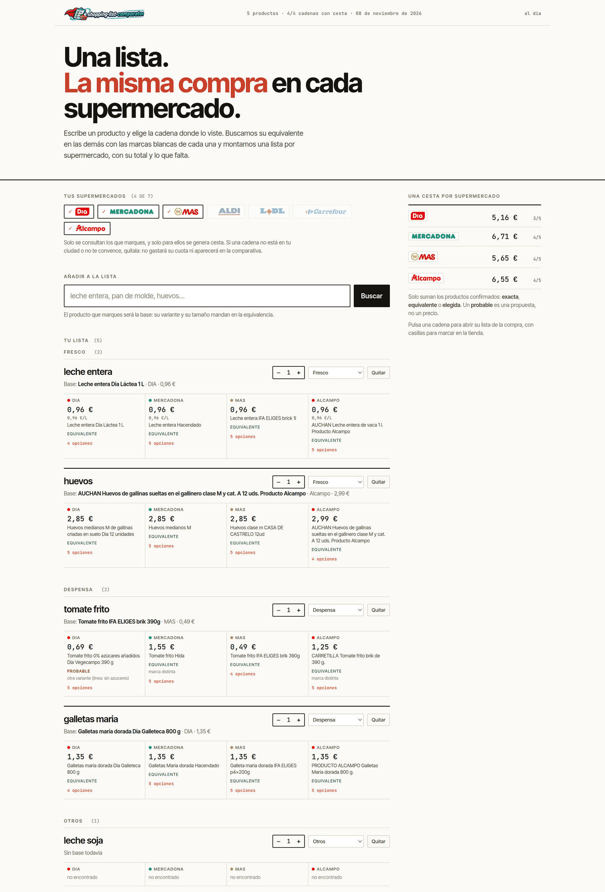
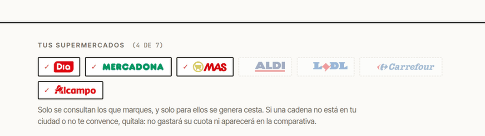
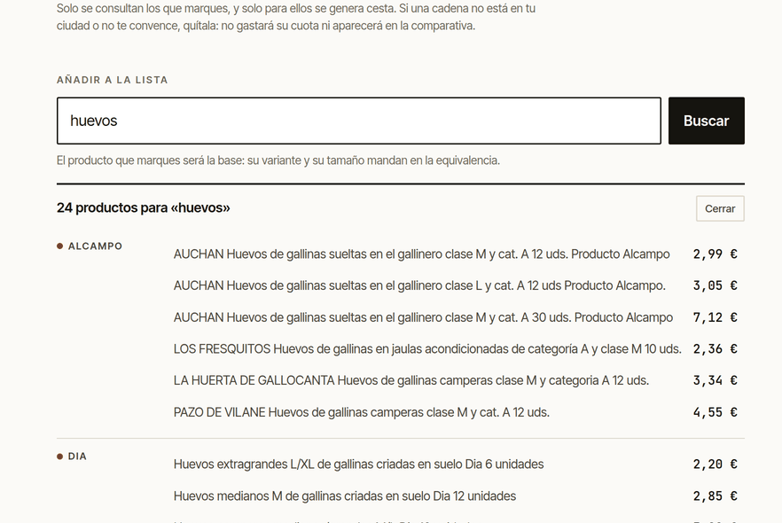
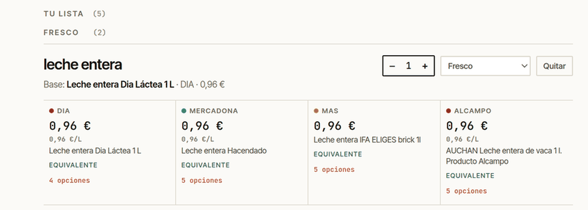
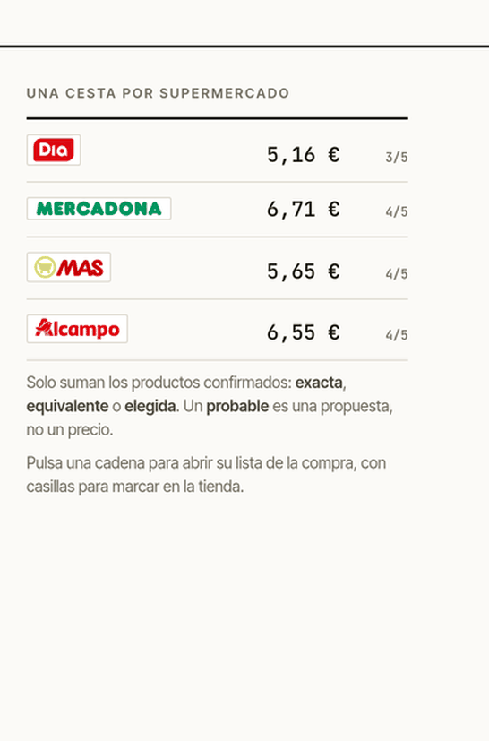
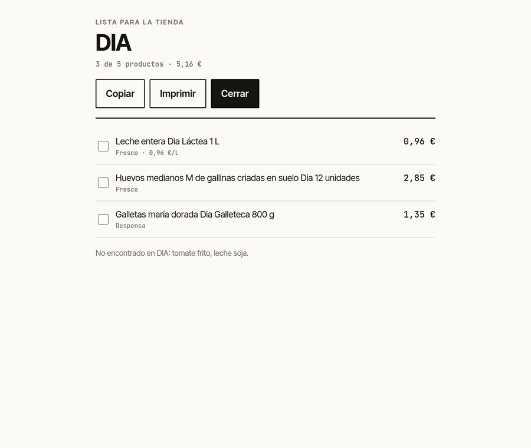
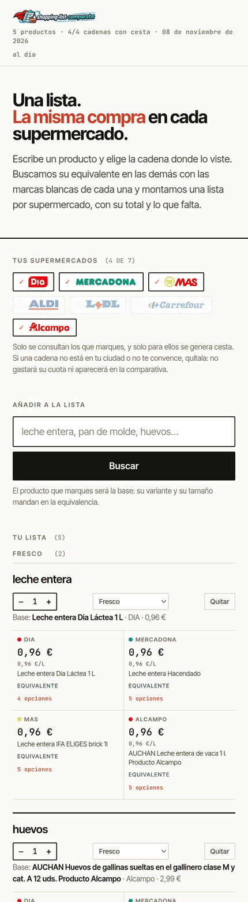

<p align="center">
  
</p>

# shopping-list-comparator

**Una lista de la compra única que se convierte en una lista por supermercado.** Escribes un producto,
eliges en qué cadena lo viste y la app busca su equivalente en las demás —marcas blancas incluidas— y
monta **una cesta por supermercado**, con cantidades, total y lo que allí falta.

No es un clon de [multisuper](https://github.com/yerbajo/multi-super) y **no declara «el más barato»**:
la pasada medida con los catálogos reales dio la misma marca blanca al mismo precio en varias cadenas
(leche entera 1 L a 0,96 € en DIA, Mercadona, ALDI y 0,95 € en MAS; huevos M 12 ud y galletas maría
dorada 800 g a idéntico precio en DIA, MAS y Mercadona). El valor está en la lista resuelta, no en un
ranking.



## Índice

- [Arrancarlo](#arrancarlo)
- [Guía de uso](#guía-de-uso) · [1. Tus supermercados](#1-tus-supermercados) · [2. Buscar y elegir](#2-buscar-y-elegir-el-producto) · [3. Leer la fila](#3-leer-la-fila) · [4. Las cestas](#4-las-cestas) · [5. Ir a la tienda](#5-ir-a-la-tienda)
- [Qué significa cada nivel](#qué-significa-cada-nivel)
- [Marcas blancas](#marcas-blancas-dato-no-código)
- [Límites medidos](#límites-medidos)
- [Interfaz](#interfaz) · [Estructura](#estructura) · [API](#api) · [Tests](#tests)

## Arrancarlo

Con Docker, en un comando. La imagen **no lleva el motor de catálogo**: apunta a un
[multisuper](https://github.com/yerbajo/multi-super) que esté sirviendo su API.

```bash
docker compose up -d --build      # http://127.0.0.1:8100, motor en el host:8099
```

```bash
SLC_MULTISUPER=http://192.168.1.245:8099 docker compose up -d   # motor en otra máquina
SLC_BIND=0.0.0.0 docker compose up -d                            # servirla en la LAN
```

La lista vive en el volumen `lista-data`; copias, restauración, actualización y problemas, en
[docs/despliegue.md](docs/despliegue.md).

Sin Docker:

```bash
# 1. el motor de catálogo, en otra terminal (repo multisuper)
go run ./cmd/web -addr 127.0.0.1:8099

# 2. la lista
go build -o bin/ ./... && bin/web -addr 127.0.0.1:8100 -multisuper http://127.0.0.1:8099 -data data/list.json
```

| Bandera | Por defecto | Qué hace |
|---|---|---|
| `-addr` | `127.0.0.1:8100` | dónde sirve la web |
| `-multisuper` | `http://127.0.0.1:8099` | motor de catálogo (`POST /api/search`) |
| `-data` | `data/list.json` | fichero de la lista |
| `-gap` | `4s` | pausa entre búsquedas; súbela si tu lista es larga |
| `-limit` | `20` | productos pedidos a cada cadena por item |

---

# Guía de uso

## 1. Tus supermercados

Lo primero: **decidir dónde compras**. Arriba de la lista están las siete cadenas con su logo; las
marcadas son las únicas que se consultan, las únicas que tienen celda en cada producto y las únicas
para las que se genera cesta. Si una cadena no está en tu ciudad, o no te convence, quítala: **no
gastará su cuota** ni aparecerá en la comparativa.



La selección se guarda con la lista (en `data/list.json` o en el volumen), así que sobrevive a
reinicios y a `docker compose up --build`. Debe quedar al menos una. Si vuelves a activar una cadena,
la app pedirá solo los productos que nunca la consultaron: lo que ya tenía respuesta no se vuelve a
preguntar.

## 2. Buscar y elegir el producto

Escribe qué quieres y pulsa **Buscar**. La app pregunta solo a tus cadenas y te enseña lo que cada una
tiene para ese término, con su precio y su €/kg o €/L. Ordena la marca propia primero y el precio
después, porque es lo que la equivalencia va a emparejar entre cadenas.



Pulsa el producto **que viste en la tienda**: ese pasa a ser la base, y su variante y su tamaño son los
que mandan en la equivalencia. La app no elige la base por ti. Un producto de otro tipo no aparece:
escribir «huevos» no ofrece huevos de chocolate, y si una cadena no tiene el producto lo dice
(«no está en su catálogo»).

> Atajo: `/?buscar=huevos` abre el buscador ya lanzado.

## 3. Leer la fila

Cada producto de la lista es una fila: el nombre, su **base** (cadena, precio y €/unidad), el contador
de **cantidad**, el **pasillo** y un botón para quitarlo. Debajo, una celda por cadena elegida.



En cada celda, de arriba abajo:

| Qué ves | Qué significa |
|---|---|
| `DIA` con su punto de color | la cadena |
| `0,96 €` | el precio que publica hoy, en céntimos enteros |
| `0,96 €/L` | su precio por unidad, **solo si la cadena lo publica**; es lo que permite comparar formatos |
| el nombre del producto | el que esa cadena vende como equivalente |
| **EQUIVALENTE** / **PROBABLE** / **NO ENCONTRADO** | el nivel de la equivalencia, con una palabra |
| `sin tamaño publicado` | el motivo, cuando el nivel no es «equivalente» |
| `5 opciones` | las alternativas de esa cadena, plegadas |

Al abrir las opciones puedes **fijar otro producto de esa cadena** o **cambiar la base** de la fila. Las
equivalencias se recalculan al instante y sin preguntar a ninguna cadena.

Cantidad y pasillo son tuyos: la cantidad multiplica el total, y el pasillo (fresco, despensa, limpieza
u otros) agrupa la lista como está ordenada la tienda. Los dos se deducen del producto y se pueden
cambiar cuando la app acierta mal.

## 4. Las cestas

La columna de la derecha es el resultado: **una cesta por supermercado**, con su total y cuántos
productos de la lista cubre. Solo suman los productos **confirmados** —`exacta`, `equivalente` o
`elegida`—; un `probable` es una propuesta, no un precio, y por eso no entra.



Si una cadena no responde, aparece su estado (`sin cuota`, `bloqueada`, `sin respuesta`) y **no
cancela a las demás**. Cuando falle por cuota o por red, debajo de la lista tienes **Reintentar**; y
**Recalcular equivalencias** vuelve a juzgar lo ya guardado con las reglas actuales, también sin gastar
cuota.

## 5. Ir a la tienda

Pulsa una cadena y se abre **su lista de la compra**: los productos con su precio, en el orden de los
pasillos, con casillas para marcar lo que ya llevas y lo que no se encontró, para que lo busques a mano.



- **Imprimir** deja solo la lista en el papel.
- **Copiar** la pone en el portapapeles como texto, lista para pegar en WhatsApp.
- **Cerrar** (o `Esc`) vuelve a la lista.
- El enlace es compartible: `/?tienda=dia` abre directamente esa lista.

En el móvil todo se recoloca a dos columnas por producto:



---

## Qué significa cada nivel

`internal/identity` aplica una escalera y **declara el resultado**, nunca lo esconde:

| Nivel | Significado | ¿Entra en el total de la cesta? |
|---|---|---|
| `exacta` | mismo código de barras (hoy solo Carrefour publica EAN) | sí |
| `equivalente` | mismo producto, misma variante y mismo tamaño | sí |
| `probable` | otra variante, otro formato o tamaño no publicado | **no** |
| `elegida` | la eligió una persona desde la fila | sí |
| `no` | el catálogo se buscó y no está | — |
| `unavailable` | la cadena no respondió; se muestra su código (`quota`, `blocked`, `timeout`…) | — |

La escalera, en orden: **EAN** → **dominio** (la puerta que rechaza menaje, mascotas, conservas y
dulces: es la que impide que un «cuecehuevos» sea un huevo) → **las palabras que pediste** (cobertura
≥ 60 % y el sustantivo de cabeza entre las tres primeras palabras del nombre) → **ejes de variante
tipados** (línea, grasa, grano, elaboración, estilo, grado, crianza, especie, tipo) → **tamaño**
normalizado a g/ml/ud, con 6 % de holgura.

Un eje tipado evita las contradicciones falsas que produjo el primer prototipo: «arroz extra» y
«arroz redondo» son el mismo producto (grado frente a grano), mientras que «tomate frito 0 % azúcares»
y «tomate frito estilo casero» no lo son —ese falso positivo valía un +74 % de precio.

## Marcas blancas: dato, no código

`internal/identity/brands.json` es el léxico. Cada cadena admite tres reglas independientes porque las
cadenas no publican la marca igual:

```json
"dia": {
  "prefix": ["dia"],            // el campo brand empieza por "dia": Dia Láctea, Diasol, Dia Vegecampo…
  "brand":  ["dia"],            // el campo brand contiene
  "name":   ["el molino de dia", "dia galleteca"]
},
"mas": {
  "name": ["ifa eliges", "ifa unnia", "ifaeliges", "ifaunnia", "masiasol"]
}
```

- **DIA** nombra una sub-marca por categoría (`Dia Láctea`, `Dia Galleteca`, `Dia Arrozona`,
  `Dia Vegecampo`, `Dia Al Punto`, `Dia Super Paco`, `Diasol`, `Dia La Llama`, `El Molino de Dia`…),
  así que la regla es un prefijo, no una lista cerrada.
- **Mercadona** publica `Hacendado`, `Deliplus`, `Bosque Verde`, `Compy`, `Solcare`, `BabySmile`.
- **MAS no publica marca nunca** (`brand` es `null` en todos sus productos): sus IFA aparecen dentro del
  nombre, a veces sin espacio (`ifaeliges`). Cuando el nombre tampoco la delata, la app dice «marca no
  publicada» en vez de inventar una paridad.
- **ALDI** publica 65+ marcas propias con `®`; **LIDL** las suyas (`Milbona`, `Sondey`, `Freeway`…);
  **Alcampo** usa `PRODUCTO ALCAMPO` y `AUCHAN` en el nombre.

Para añadir una marca: una línea en `brands.json` y un caso en `TestOwnBrand`. Nada más.

## Límites medidos

Pasada real del 2026-11-08 con los catálogos de las siete cadenas:

| Cadena | Qué se encontró | Consecuencia en la app |
|---|---|---|
| DIA | 100 % con marca publicada y tamaño en el nombre | la mejor fuente de base |
| Mercadona | marca y `size` publicados | equivalencias exactas de tamaño |
| MAS | marca `null`; tamaño en el nombre (`p4x200g`, `1k`) | marca blanca detectada por léxico |
| ALDI | **no publica tamaño** | casi todo queda en `probable` |
| LIDL | su búsqueda por texto devuelve menaje para términos de comida | 9 de 10 items sin candidato; necesita recuperación por categoría |
| CARREFOUR | 3 peticiones/minuto (Superfudis); sí publica EAN y tamaño | aparece como `quota` en listas largas |
| ALCAMPO | WAF de AWS (HTTP 202) intermitente | aparece como `quota` |

Por eso la resolución va **en segundo plano, de una en una y con pausa** (`-gap`), y por eso se puede
elegir el conjunto de cadenas: cada consulta es una petición real a un catálogo ajeno.

## Interfaz

Identidad propia, no la de multisuper: papel casi blanco, tinta negra, un solo acento rojo tomate,
grotesca grande para los titulares y monoespaciada para las cifras. La firma es la regla: 2 px de tinta
encima de cada fila y filetes de 1 px separando las cadenas, como una tabla de periódico. El nivel se
dice con una palabra; el color solo tiñe esa palabra y cada cadena lleva su marca.

Sin CDN y sin build: las dos fuentes (Inter Tight variable y JetBrains Mono, subset latin + latin-ext)
están en `web/fonts/` y se embeben en el binario, 168 KB en total; el logotipo (`web/logo.png`, con el
fondo recortado) y su favicon van también dentro; y los siete logos de cadena están en
`web/logos.svg`, recortados a su propio dibujo y reutilizados de multisuper. Las animaciones son
transiciones CSS de 100–150 ms sobre propiedades concretas, `scale(0.96)` al pulsar y nada cuando el
sistema pide movimiento reducido.

## Estructura

```
cmd/web/              servidor HTTP, API y la página
internal/identity/    la escalera de equivalencia + brands.json + los tests del corpus real
internal/catalog/     cliente de POST /api/search (multisuper), céntimos, €/unidad y selección de cadenas
internal/store/       la lista en un JSON con escritura atómica
internal/resolve/     cola en segundo plano, base automática, alternativas
web/                  index.html, styles.css, app.js, logo.png, favicon.png, logos.svg y fuentes
Dockerfile            imagen de dos etapas, usuario sin privilegios, lista en /data
docker-compose.yml    la lista con su volumen y el motor del host
docs/despliegue.md    Docker, copias, LAN, actualización y problemas
odd/tasks/            las specs del trabajo, con las peticiones literales y la evidencia
```

La lista es un fichero local (`data/list.json`); no hay cuentas, ni servidor de terceros, ni histórico
de precios.

## API

| Método y ruta | Qué hace |
|---|---|
| `GET /api/state` | la lista entera: productos, celdas por cadena, cestas y selección |
| `POST /api/search` | `{"query":"huevos"}`: lo que cada cadena tiene, para elegir (caché de 30 s) |
| `POST /api/items` | `{"query":"leche entera","anchor":{…}}`: añade con ese producto como base |
| `PATCH /api/items/{id}` | `{"quantity":2}` o `{"section":"despensa"}` |
| `DELETE /api/items/{id}` | quita un producto |
| `POST /api/items/{id}/pick` | `{"store":"aldi","id":"…"}`: fija ese producto en esa cadena |
| `POST /api/items/{id}/anchor` | `{"store":"dia","id":"…"}`: cambia la base y recalcula sin gastar cuota |
| `POST /api/items/{id}/retry` · `POST /api/retry` | reintenta lo que falló por cuota o red |
| `POST /api/recompute` | vuelve a juzgar lo guardado con las reglas actuales, sin red |
| `POST /api/stores` | `{"chains":["dia","mas"]}`: qué supermercados entran en la comparativa |

Enlaces directos: `/?tienda=dia` abre la lista de esa cadena y `/?buscar=huevos` abre el buscador.

## Tests

```bash
go test ./...
```

Los casos de `internal/identity` son nombres y precios reales medidos con `multisuper find`. Cuatro
falsos positivos viven ahí como casos negativos permanentes: `SILVERCREST® Cuecehuevos` (huevos),
`LIVARNO HOME Escobobilla de váter` (papel higiénico), `Filetes de anchoa en aceite de girasol`
(aceite de girasol) y `Juego de moldes de silicona` (pan de molde), más el +74 % de «tomate frito
estilo casero», los huevos de codorniz frente a los de gallina y los huevos de chocolate en el
buscador. `cmd/web/deploy_test.go` comprueba además que el despliegue documentado sigue siendo el que
este repo produce.

## Marcas y datos

Las marcas de las cadenas son de sus titulares y se usan solo para identificarlas. Los precios los
publica cada cadena en el momento de la consulta y esta app no los guarda como histórico.
